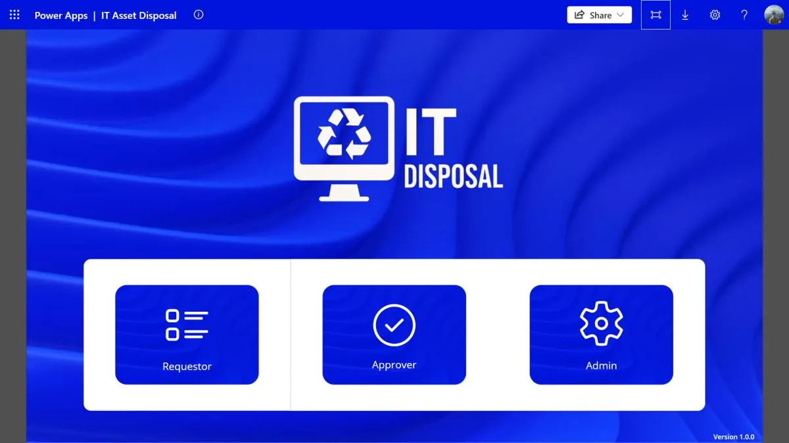
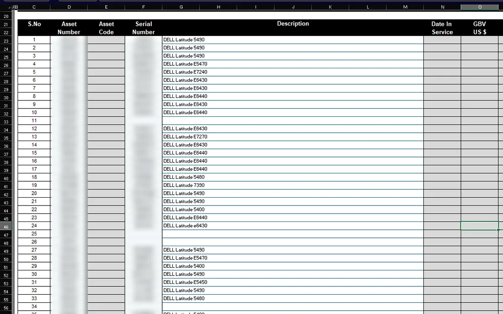
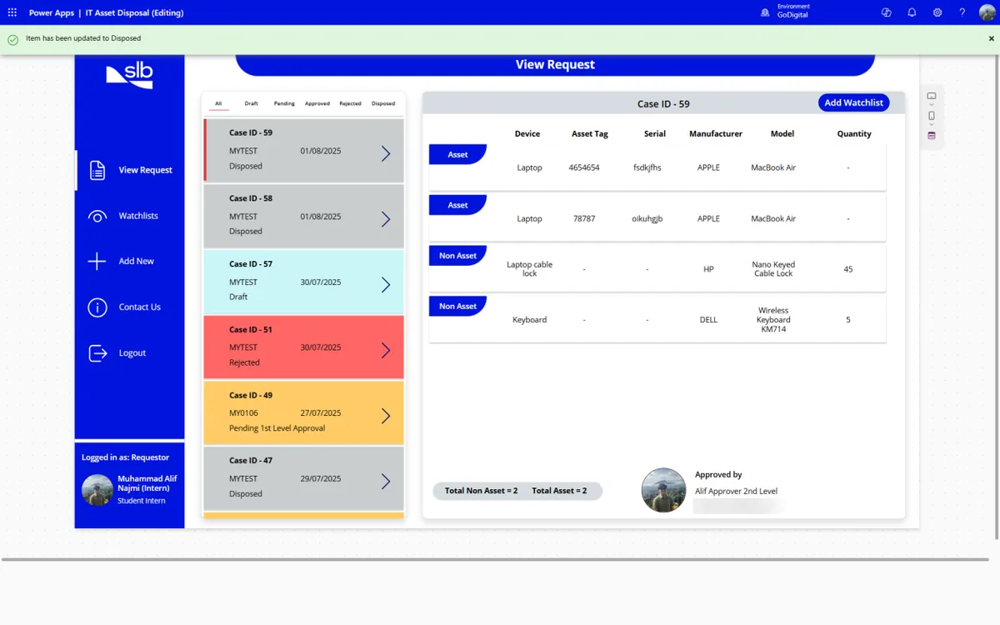
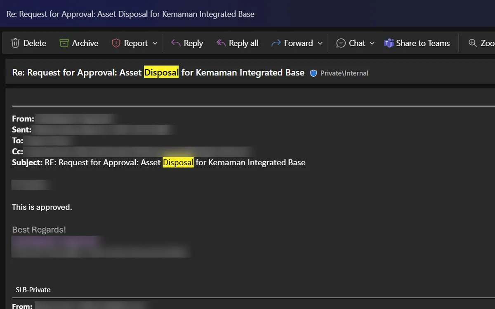
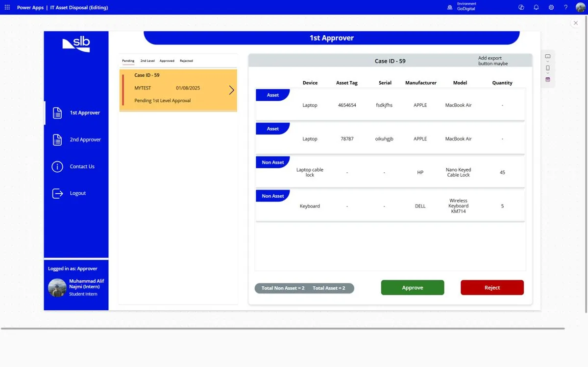
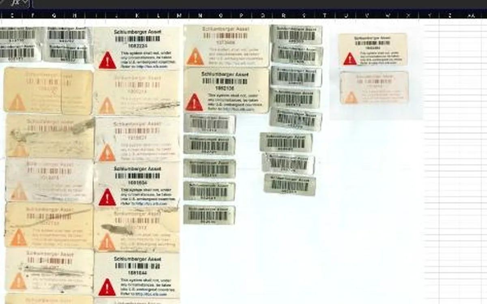
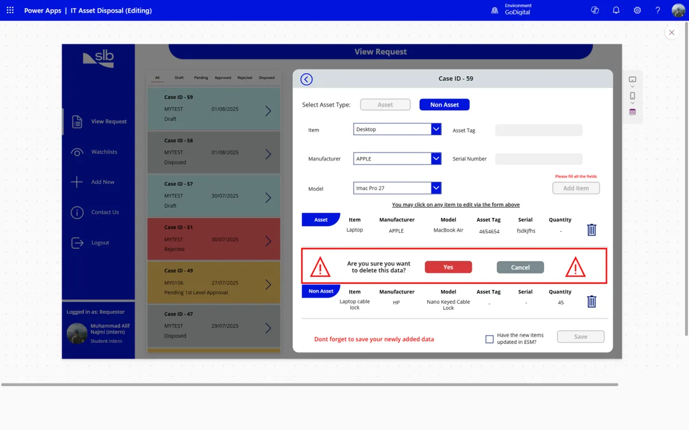
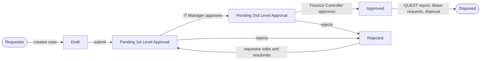

# IT Asset Disposal

**A Power Apps app that replaced an e-waste disposal process run on Excel sheets and email chains.**
Built during my 8-month Digital IT Operations internship at SLB (Kemaman, Terengganu), January to August 2025,
as my Student Industrial Project for Universiti Teknologi PETRONAS.

> This repo is a portfolio copy. It holds the app's real source, exported from Power Apps and unpacked
> into readable YAML, plus the design docs. SharePoint site addresses, list IDs, connection details and
> colleagues' names are not included, and screenshots have personal details blurred.
> The prototype itself was handed over to SLB's GoDigital team to refine and publish.



## The problem

When IT equipment at the base reached end of life, the disposal process looked like this:

1. Every laptop, desktop, cable lock and keyboard was logged by hand in an Excel sheet, one tab per device type.
2. The finished list was emailed to the IT Manager for approval.
3. Their reply was forwarded to the Finance Controller for a second approval.
4. Only then could the QUEST risk report, IBase manpower requests and the physical disposal begin.

| Before: one long Excel sheet per device type | After: one list of cases, coloured by status |
|---|---|
|  |  |

Data was spread across spreadsheets, inboxes and shared drives. Nobody could see where a request was
without scrolling through a reply-all thread, and nobody was told when something changed.

| Before: approvals in an email chain | After: an approver screen with two buttons |
|---|---|
|  |  |

## What the app does

- **One place for every disposal case.** A requestor picks their base, adds items (asset or non-asset),
  and saves a case. The approvers for that base fill in automatically from the location list.
- **Two-level approval inside the app.** The IT Manager approves or rejects, then the Finance Controller.
  A rejected case goes back to the requestor to edit and resubmit.
- **Role-based screens.** The login screen only shows the buttons a user is allowed to use:
  Requestor for everyone, Approver for people named as approvers on a case, Admin for admins.
- **Watchlist.** A requestor can add colleagues to a case so they can view, edit or submit it too.
- **Admin screens** to manage admins, approvers, locations and requestors.
- **Contact Us** form for questions and bug reports to the development team.

| Before: asset tags pasted into a sheet | After: a form with dropdowns for item, brand and model |
|---|---|
|  |  |

## How it fits together



More detail:

- [Workflow and statuses](docs/workflow.md)
- [Data model](docs/data-model.md): 10 SharePoint lists, normalised to 3NF
- [Roles and access](docs/roles-and-access.md)
- [Key formulas](docs/key-formulas.md): the Power Fx behind login, saving a case and approvals
- [Design and lessons learned](docs/design-and-lessons.md)
- [Original draw.io charts](docs/diagrams.md): the full flow and access-control charts I designed in draw.io, all 9 pages
- [Project timeline](docs/timeline.md): dated milestones from my SIP logbook
- [What the live lists show](docs/live-data-review.md): how the final version was used, and its data problems

## What's in this repo

```
src/                    the app's screens and components as Power Apps YAML (.pa.yaml)
  App.pa.yaml           startup logic: records each new user in the Requestor list
  Login.pa.yaml         role picker and approver routing
  Requestor_*.pa.yaml   create, view and edit cases
  Approver_*.pa.yaml    1st and 2nd level approval screens
  ADMIN Set *.pa.yaml   admin screens for admins, approvers, locations and requestors
  Contact Us.pa.yaml    support form
  Components/           the three navigation sidebars (requestor, approver, admin)
docs/                   workflow, data model, roles, formulas, design notes and screenshots
  diagrams/             the original draw.io file with the flow and access-control charts
sample-data/            the SharePoint list structure as CSV, filled with made-up records
```

### About this copy of the source

The source comes from the copy of the app I kept in my university Power Apps environment. Compared with
the final version described in my internship report:

- The **login, request, watchlist, admin and contact screens** are all here and complete: creating a case,
  adding and editing items, and submitting it for approval.
- The **1st and 2nd level approver screens** are here with their case lists, filters and confirmation
  pop-ups, but in this copy the confirm button still runs placeholder logic. Wiring approve and reject to
  the case status was finished later in SLB's environment.
- The **QUEST/IBase recording and "Disposed" confirmation** steps were also added later and are not in
  this copy.
- [What the live lists show](docs/live-data-review.md) confirms the final version did reach every status,
  including approval and rejection at both levels and *Disposed*, and lists the data problems that v2 fixes.
- The **email notifications** were Power Automate flows, which live outside the app file, so they are
  described in [docs/workflow.md](docs/workflow.md) rather than included as code.

The app won't run as-is: it was built against SLB's SharePoint lists. To try it, create lists that match
[sample-data/](sample-data/) in your own SharePoint site and point the app's data sources at them.

## What came next

[it-asset-disposal-app-v2](https://github.com/7YMERA/it-asset-disposal-app-v2) is a redesign of this app
outside SLB, built from the lessons here. This repo stays as the record of the original.

## Built with

Microsoft Power Apps (canvas app, Power Fx) · SharePoint Online lists · Power Automate · Office 365 Users
connector · worked in Agile sprints with SLB's GoDigital developers.

## Context

- **Intern:** Muhammad Alif Najmi, Digital IT Operations intern, SLB Malaysia (Jan–Aug 2025)
- **Course:** Student Industrial Project, Bachelor of Computer Science, Universiti Teknologi PETRONAS
- **More of my work:** [7ymera.github.io](https://7ymera.github.io)

This is a personal portfolio repository and is not an official SLB product or publication.
