# IT Asset Disposal

**The story of the Power Apps app I built during my internship at SLB to replace an e-waste disposal
process that ran on Excel sheets and email chains.**

Digital IT Operations intern · SLB Kemaman, Terengganu · 2025 · Student Industrial Project,
Universiti Teknologi PETRONAS


> This repo is my portfolio record of the project. It holds the app's real source, unpacked from Power
> Apps into readable YAML, the original design charts and this write-up. Colleagues' names, SharePoint
> addresses and internal links are left out, and screenshots have personal details blurred. The app itself
> was handed over to SLB's GoDigital team.

---

## Chapter 1: Five trolleys of old laptops

The Kemaman base is also a warehouse for IT equipment, so a lot of hardware reaches the end of its life
there. On 22 June 2025 I helped clear the IT store with the facility team. It took more than five trolleys
to move everything out, some of it 10 to 12 years old.

Every one of those items had to go through the disposal process, and that process looked like this:

1. **Log it in Excel.** Each laptop, desktop, cable lock and keyboard was typed into a spreadsheet by
   hand, with one tab per device type and more tabs for approval emails, the QUEST report and invoices.
2. **Email the IT Manager** with the sheet attached, and wait.
3. **Forward their reply to the Finance Controller** for a second approval, in the same thread.
4. **Only then dispose:** raise a QUEST safety report and IBase manpower requests, destroy hard drives
   with photo proof, and hand everything to the facility team.

| The old way: one long Excel sheet per device type | Asset tags pasted into the sheet by hand |
|---|---|
|  |  |


*Approvals lived in reply-all email chains like this one.*

What went wrong:

- The data was spread across spreadsheets, inboxes and shared drives, so it got out of sync.
- Nobody could see where a request stood without scrolling through an email thread.
- Nobody was told when something changed.
- There was no single record to show an auditor.

My project was to put the whole process in one app.

---

## Chapter 2: Paper first

Before touching Power Apps, I drew the screens on paper and walked through them with the GoDigital
developers. We kept the layout close to other internal SLB apps so staff would feel at home.

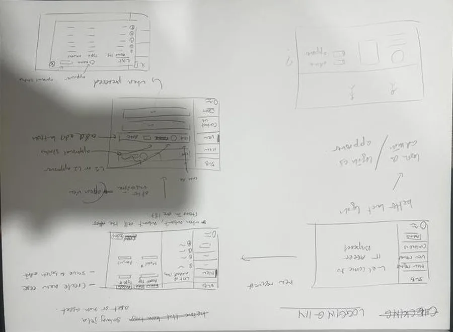

The first flowchart started in LucidChart and moved to draw.io. This is the first version I was happy
with, the **MVP**. It has four lanes: the requestor, the system, an admin, and one "third party" approver,
with a note to repeat the whole cycle for the Finance Controller.

[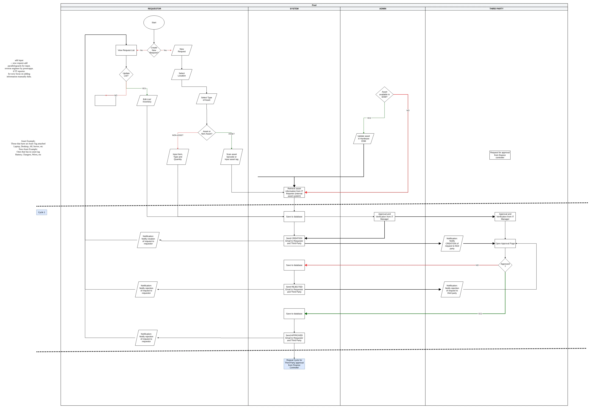](docs/images/charts/mvp-flow.webp)

*Click any chart to open it full size.*

The data side started just as broad. This first ERD tried to model everything: users, locations, assets,
non-assets, the request, approvals, dismantling, documents, certificates and reports.

[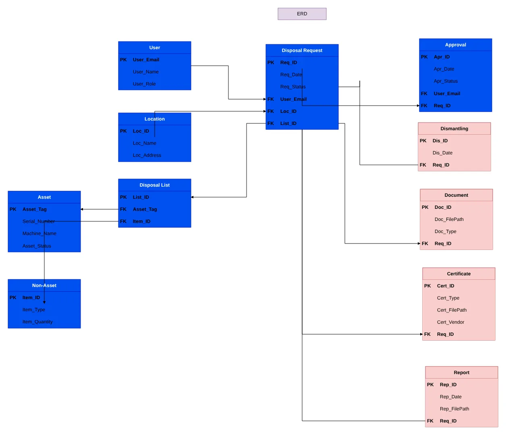](docs/images/charts/erd-team-draft.webp)

---

## Chapter 3: Drawing the whole flow

Over the next weeks the chart grew one round of feedback at a time, and draw.io kept every version as a
separate page:

1. **MVP:** one approver lane, repeated
2. **Bulk setting adjustment:** the IT Manager and Finance Controller get their own lanes, and QUEST and
   IBase numbers are recorded after approval
3. **Mid row adjustment:** every email is spelled out, including who is in TO and who is in CC
4. **Add home function:** a home page with *Create*, *View My Requests* and *Help / Feedback*
5. **Final, admin separation:** the admin side becomes its own chart

Here is the flow with the home page added. Read it lane by lane, left to right: **Requestor**, **System**,
**IT Manager**, **Finance Controller** and **Admin**. The dotted lines split it into stages: building the
list, 1st level approval, 2nd level approval, then disposal.

[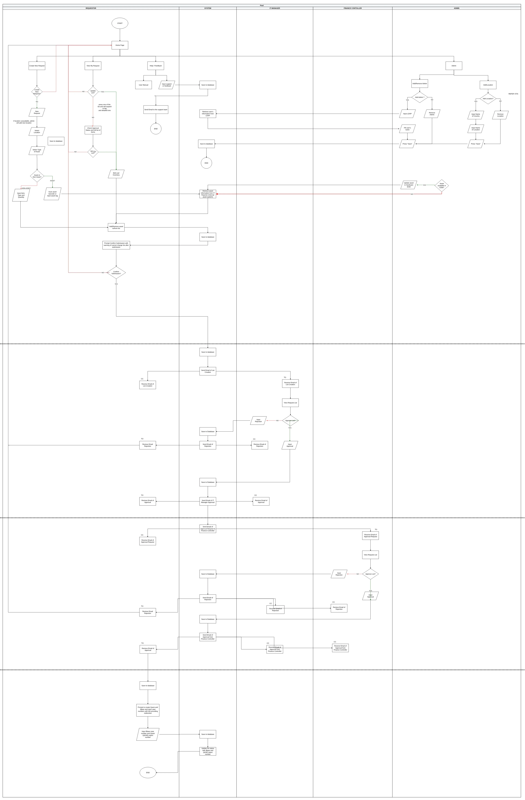](docs/images/charts/home-function-flow.webp)

### The final flow

The last version tidied the requestor, system and approver lanes into one long chart, from *Create new
request* at the top to entering the QUEST and IBase numbers at the bottom.

<p align="center">
  <a href="docs/images/charts/final-flow.webp">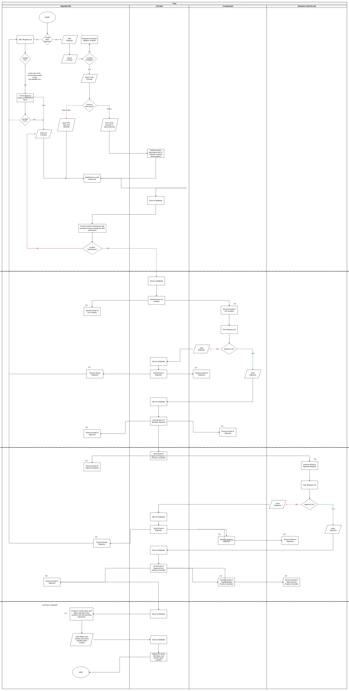</a>
</p>

### The access controls

The admin's powers were split out into their own chart. Admins can view, add, edit and delete four
things, and every change is saved straight to SharePoint:

- **Admins:** who else can manage the app
- **Locations:** each base, and who approves for it
- **Requestors:** who has used the app
- **Approvers:** the IT Manager and Finance Controller for each base

<p align="center">
  <a href="docs/images/charts/final-admin-access.webp">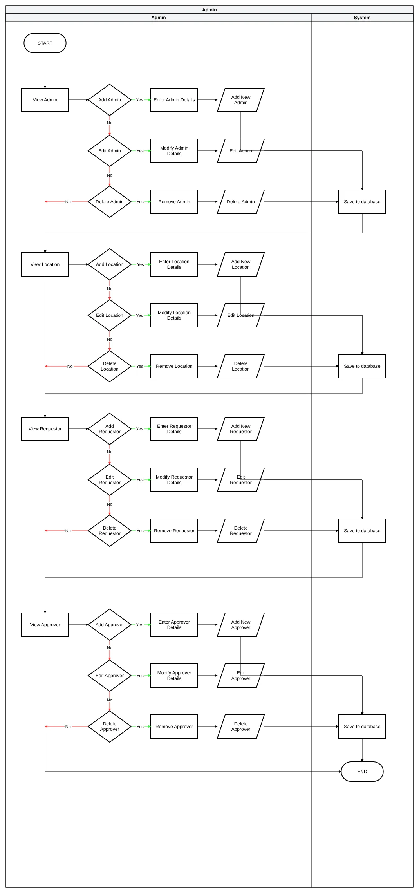</a>
</p>

### Cutting the data down

The eleven-table ERD was cut down to what the process actually needed, and normalised to third normal
form (3NF) so each fact is stored once.

| My hand-drawn ERD draft | The normalised ERD |
|---|---|
| 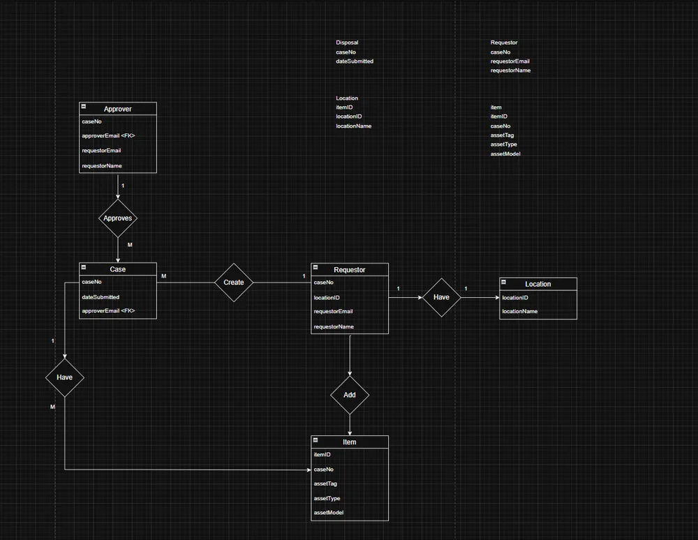 | 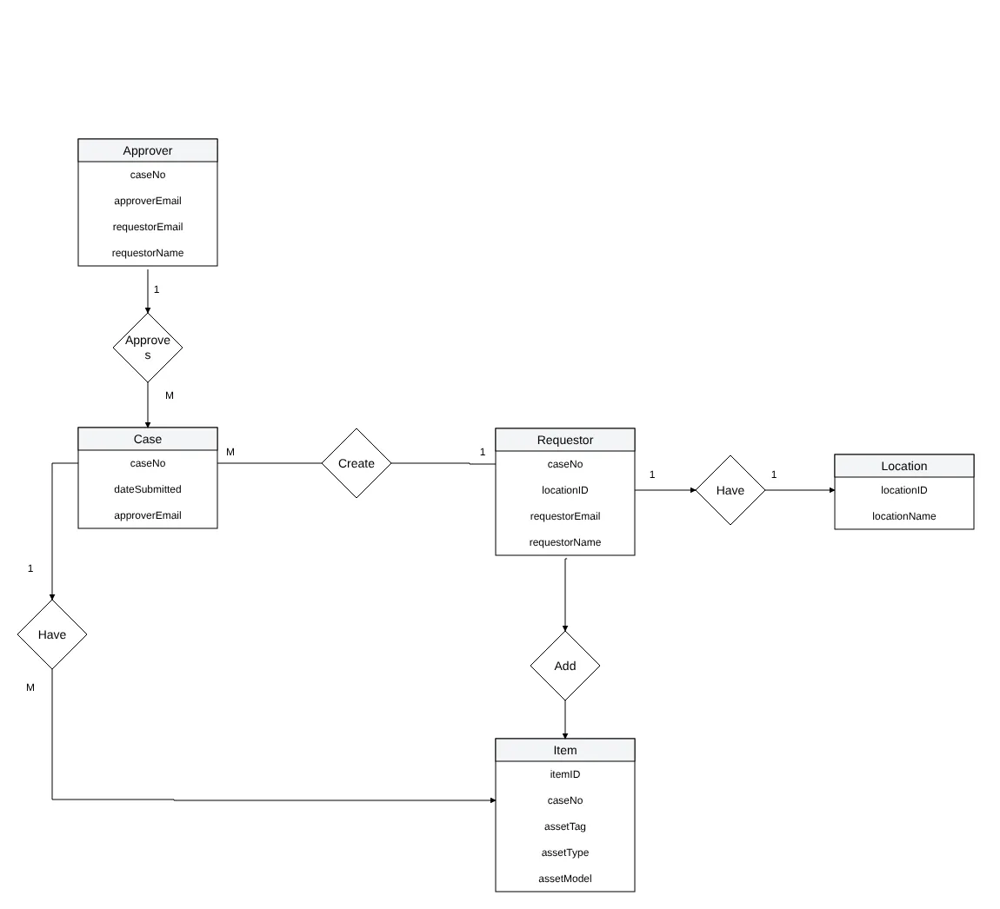 |

In the finished app this became SharePoint lists:

| List | What it holds |
|---|---|
| Case | One row per disposal case: base, requestor, both approvers and status |
| Item | Each item in a case. Assets have a tag and serial number; non-assets (cables, mice, locks) have a quantity |
| Location | Each base, with its 1st and 2nd level approvers |
| Watchlists | Colleagues added to a case so they can view, edit or submit it |
| IT Asset Lists | The catalogue of device types, brands and models behind the dropdowns |
| Requestor, Approver, Admins | Who can do what |
| QUEST Number, IBase Number | Reference numbers recorded on an approved case |
| Contact Support Info | Questions and bug reports from the Contact Us screen |

One choice I'm still glad about: the approvers' names are **copied onto each case** when it's created. If a
base's approver changes later, cases already in someone's queue don't jump to a new person.

---

## Chapter 4: Building it

I built the app in Power Apps on top of the SharePoint lists, with Power Automate sending the emails.

### Logging items

A requestor picks their base, then adds items. The form changes depending on what you're disposing of:

- **Asset** (laptops, desktops, tablets): needs its own asset tag and serial number
- **Non-asset** (cable locks, mice, keyboards, adapters): just a type and a quantity

| Before: typed into Excel | After: dropdowns for item, brand and model |
|---|---|
|  |  |

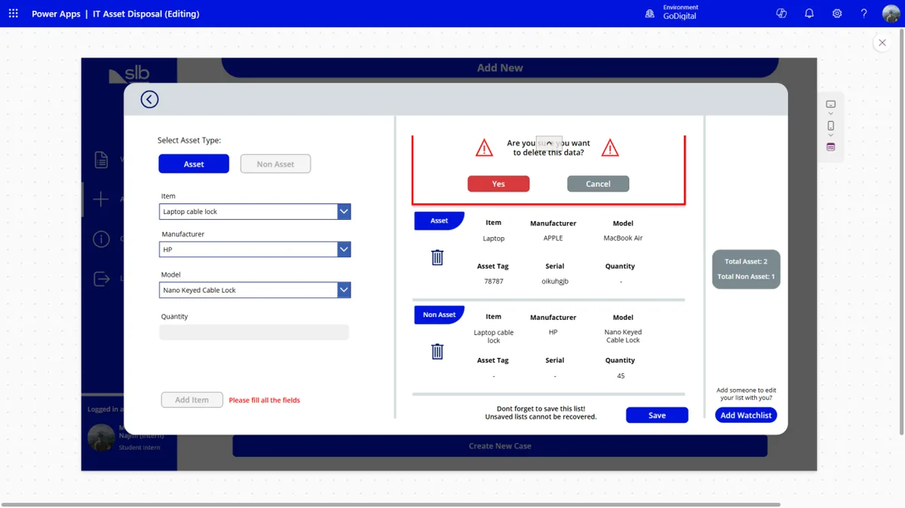

### Tracking a case

Every case shows up as a card coloured by its status, so you can see where everything stands at a glance.

| Before: scrolling a spreadsheet | After: one list of cases, coloured by status |
|---|---|
|  |  |

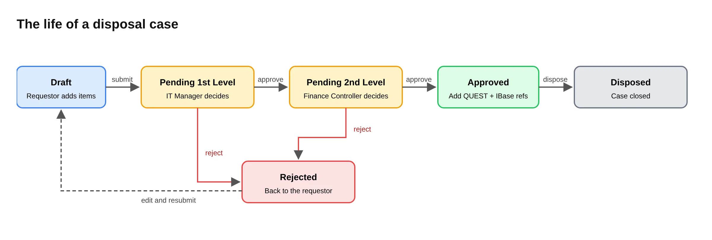

| Status | Who acts next | Colour |
|---|---|---|
| Draft | Requestor adds, edits or removes items, then submits | Light blue |
| Pending 1st Level Approval | IT Manager for that base | Amber |
| Pending 2nd Level Approval | Finance Controller for that base | Amber |
| Rejected | Requestor edits and resubmits | Red |
| Approved | Requestor records the QUEST and IBase numbers, then disposes | Green |
| Disposed | Nobody: the case is closed | Grey |

### Approving

Approvers get their own screen with their queue and two buttons, instead of an email thread.

| Before: approvals in an email chain | After: an approver screen |
|---|---|
|  |  |

### Who sees what

| Role | Can do |
|---|---|
| **Requestor** | Create cases, edit them while Draft or Rejected, submit, add colleagues to the watchlist, record QUEST and IBase numbers |
| **IT Manager** (1st level) | See cases waiting for them, approve or reject |
| **Finance Controller** (2nd level) | Final approval before anything is disposed |
| **Admin** | Manage admins, bases, approvers and requestors |

- **Everyone is a requestor.** When the app opens, it reads your Microsoft 365 name and email and adds
  you to the Requestor list. Nobody has to ask for access.
- **Approvers are found from the cases.** Pressing *Approver* checks whether your email is the 1st or 2nd
  approver on any case, then opens the right screen. Nobody keeps an approver list by hand.
- **Each approver sees only their own queue.**
- **The watchlist** lets a requestor share a case with colleagues so they can act on it too.

### Emails

Power Automate flows watched the lists and emailed people at each step:

- **Case created:** the requestor and anyone on the watchlist
- **Submitted:** the IT Manager
- **Approved at 1st level:** the Finance Controller, with everyone on the case in CC
- **Approved or rejected at 2nd level:** everyone on the case
- **Contact Us form:** the support team

### What was hard

- **Delegation limits.** Power Apps can only push some filters down to SharePoint. Anything else only
  looks at the first few hundred rows, so cases could silently go missing as the lists grew. I loaded
  just the current case's items into local collections and did the filtering there.
- **Learning Power Fx from scratch.** It's formula-based, and most logic lives on button presses. Weekly
  check-ins with the GoDigital developers, and ChatGPT for debugging expressions, got me through.
- **Showing each person only their cases.** Requestors, approvers and watchlist members all see different
  slices of the same lists, so every gallery filters on the signed-in user's email.

---

## Chapter 5: Testing, numbers and handover

| When (2025) | What happened |
|---|---|
| 15 May | Reviewed the flowchart and storyboard with the GoDigital team |
| 19 June | First test cases saved to SharePoint |
| 22 June | Cleared the IT store: more than five trolleys of old equipment |
| 25 June | Started the UI design with the KL Digital team |
| 3 July | Presented progress to GoDigital |
| 10 July | Cases now filled in their approvers automatically from the Location list |
| 19 to 22 July | First case submitted for approval |
| 21 July | Swapped ideas with an SLB intern in Labuan who was building a similar app |
| 27 to 29 July | Front end, back end and email flows finished; first case closed as *Disposed* |
| 30 July | My host supervisor tested it end to end, including rejection at both levels |
| 6 August | Final presentation to my UTP supervisor at SLB Kemaman |
| 7 to 12 August | Wrote the user guide and handed the app over |

By handover, the live lists showed every part of the flow had been used:

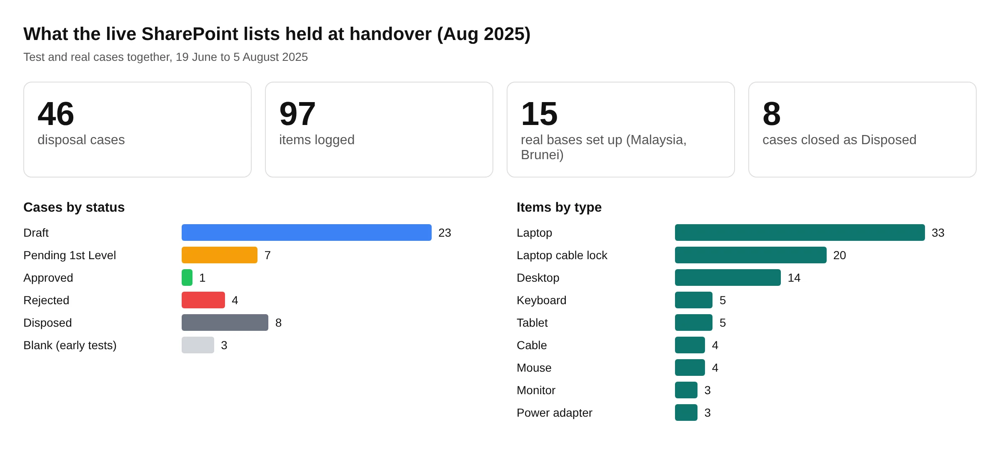

The data also showed what a stricter build would catch. Item case numbers were stored as text, so one
item pointed at a case called "urmmmm". Approvals were stored as `true`, `True` and `False`. Brands were
typed freely, so `DELL` and `Dell` both appear. None of this broke the app, but these are exactly the
problems the redesign fixes.

---

## Chapter 6: What I took from it

- **Audit trail.** Every case, item and status change is time-stamped in one place instead of scattered
  across inboxes.
- **Less waste.** Proper records of what was disposed and why support responsible e-waste handling.
- **Less admin.** No more switching between Excel, Outlook and shared drives to push one request through.

What I'd do next: an export button so a case can be handed to auditors, and a move off SharePoint lists to
drop the delegation workarounds.

### What came next

I'm rebuilding it as a standalone web app outside SLB:
**[it-asset-disposal-app-v2](https://github.com/7YMERA/it-asset-disposal-app-v2)**. This repo stays as the
record of the original.

---

## About this repo

```
src/                    the app's screens and components as Power Apps YAML (.pa.yaml)
docs/images/            screenshots and the rendered design charts
docs/diagrams/          the original draw.io file (all 9 pages)
docs/                   deeper notes: workflow, data model, roles, key formulas, live data review
sample-data/            the SharePoint lists as CSV, filled with made-up records
```

**About this copy of the source.** It comes from the copy I kept in my university Power Apps environment,
which is earlier than the final version at SLB. Login, requests, watchlist, admin and contact screens are
complete. In this copy the approver screens' confirm button still runs placeholder logic, and the QUEST,
IBase and *Disposed* steps were added later in SLB's environment. The live list data above confirms the
final version did all of these. The email flows lived in Power Automate, outside the app file.

The app won't run as-is because it was built against SLB's SharePoint lists. To try it, create lists that
match `sample-data/` in your own SharePoint site and point the app's data sources at them.

**Built with:** Microsoft Power Apps (canvas app, Power Fx), SharePoint Online lists, Power Automate,
Office 365 Users connector, draw.io, working in Agile sprints with SLB's GoDigital developers.

**More of my work:** [7ymera.github.io](https://7ymera.github.io)

This is a personal portfolio repository and is not an official SLB product or publication.
