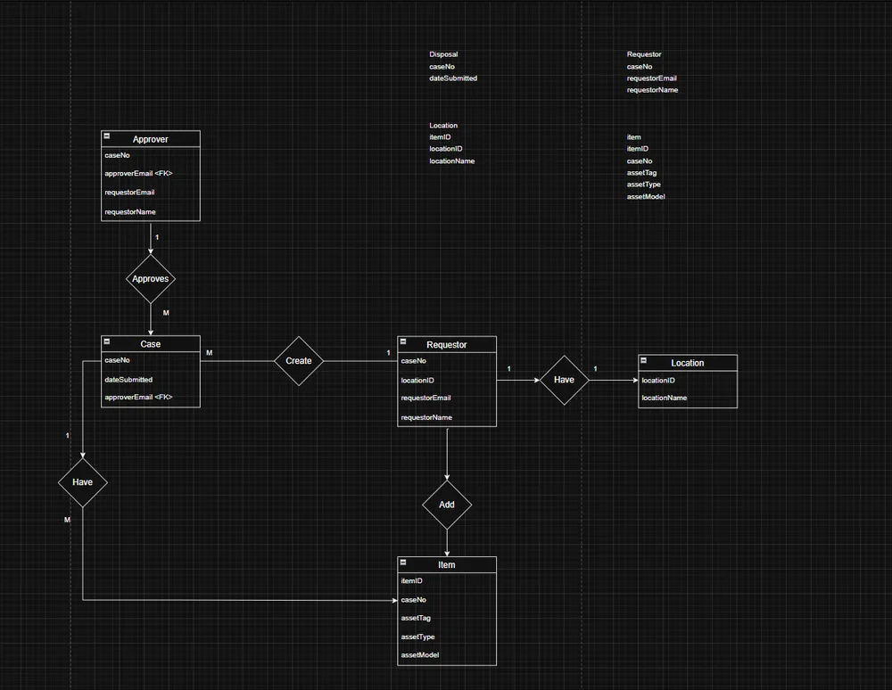
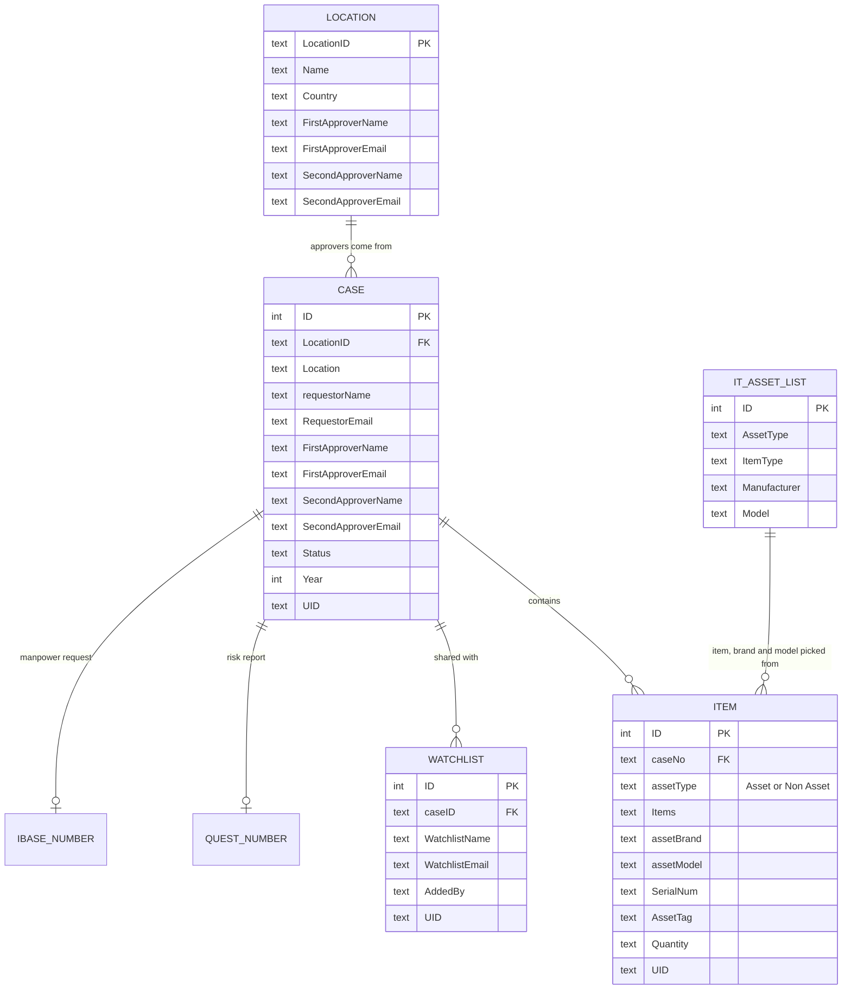

# Data model

The app stores everything in SharePoint Online lists. The design started as an ERD on paper and was
normalised to third normal form (3NF): each fact is stored once, and lists point at each other by ID.

The approvers' names and emails are copied from the location onto each case on purpose. If a base's
approver changes later, cases already in progress keep the approver they were submitted to.

## The lists

| List | What it holds |
|---|---|
| ITAssetDisposal-Case | One row per disposal case: base, requestor, both approvers and status |
| ITAssetDisposal-Item | Each item in a case. Assets have a tag and serial number; non-assets (cables, mice, locks) have a quantity |
| ITAssetDisposal-Location | Each base, with its 1st and 2nd level approvers |
| ITAssetDisposal-Watchlists | Colleagues added to a case so they can view, edit or submit it |
| IT Asset Lists | The catalogue of device types, brands and models that feeds the item dropdowns |
| Requestor | Everyone who has opened the app, recorded automatically at startup |
| Approver | Approvers and their level |
| Admins | Users who can manage locations, approvers and other admins |
| QUEST Number, IBase Number | Reference numbers for the risk report and manpower requests on an approved case |
| Contact Support Info | Questions and bug reports sent from the Contact Us screen |

[`sample-data/`](../sample-data) has the main lists as CSV with made-up records, so you can rebuild them
in your own SharePoint site.

## Asset vs non-asset

SLB tracks some equipment individually and some in bulk, so items come in two kinds:

- **Asset:** laptops, desktops, tablets. Each has its own asset tag and serial number, and quantity is `-`.
- **Non-asset:** cable locks, mice, keyboards, power adapters. No tag or serial, just a quantity.

The add-item form switches its fields depending on which one you pick.
