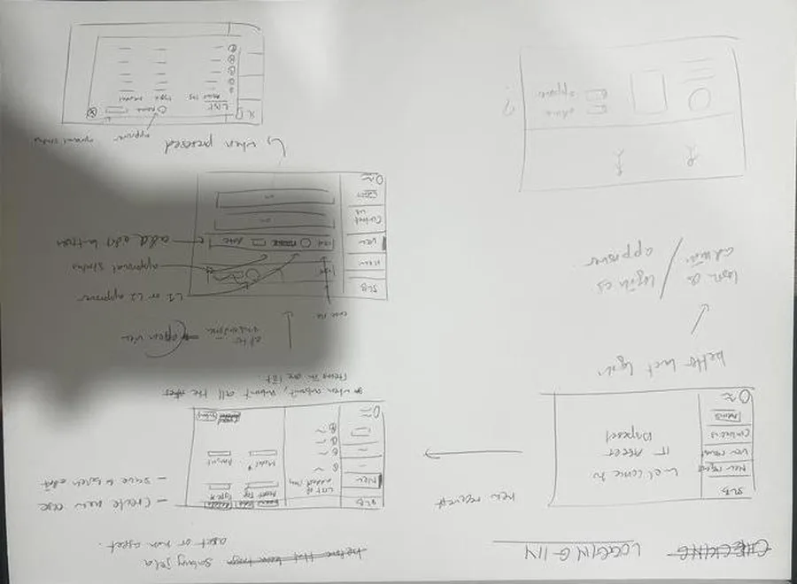
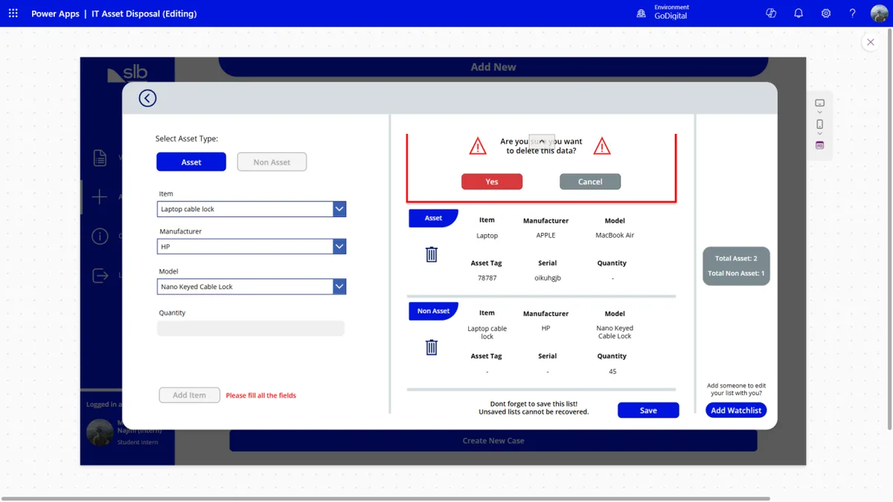

# Design and lessons learned

## From paper to app

I started with paper storyboards of the main screens, then borrowed layout and colour ideas from other
internal SLB apps and SLB's media bank so the app would feel familiar to staff.

Design rules I stuck to:

- **Colour means status.** Every case card is coloured by where it is: blue for draft, amber for waiting,
  red for rejected, green for approved, grey for done.
- **Confirm anything you can't undo.** Deleting an item, leaving a half-built case, and submitting for
  approval all ask first, because a submitted case is locked until it's rejected.
- **Plain labels over training.** Most users were IT staff and managers who had never used a Power App,
  so screens use short labels and one obvious action.

## Milestones

The project ran from January to July 2025, in this order:

1. SIP onboarding and orientation
2. Analysing and documenting the existing disposal process
3. Storyboarding and system design
4. Power Apps sandbox access and SharePoint backend set up
5. Building the forms and connecting them to SharePoint
6. Testing, fixing and refining
7. Final prototype rollout and sustainability documentation

## What was hard

- **Delegation limits.** SharePoint filters that Power Apps can't delegate only look at the first few
  hundred rows. I moved the heavy filtering into local collections loaded per case
  (see [key formulas](key-formulas.md#editing-a-draft-without-hitting-delegation-limits)).
- **Learning Power Fx from scratch.** It's formula-based, not a normal programming language, and most
  logic lives on button presses. Weekly check-ins with the GoDigital developers, and ChatGPT for
  debugging expressions, got me through the first months.
- **Showing each person only their cases.** Approvers, watchlist members and requestors all see
  different slices of the same lists, so every gallery filters on the logged-in user's email.

## Why it mattered

- **Audit trail.** Every case, item and status change is time-stamped in SharePoint, instead of being
  scattered across inboxes.
- **Less waste.** Proper records of what was disposed and why support responsible e-waste handling,
  and the paper forms went away.
- **Less admin.** No more switching between Excel, Outlook and shared drives to push one request through.

## What I'd do next

- Add an export button on the approver screen, so a case can be saved for auditors (it's still marked "Add export button maybe" in the design).
- Move the lists to Dataverse to drop the delegation workarounds altogether.

The full redesign is in [it-asset-disposal-app-v2](https://github.com/7YMERA/it-asset-disposal-app-v2).
