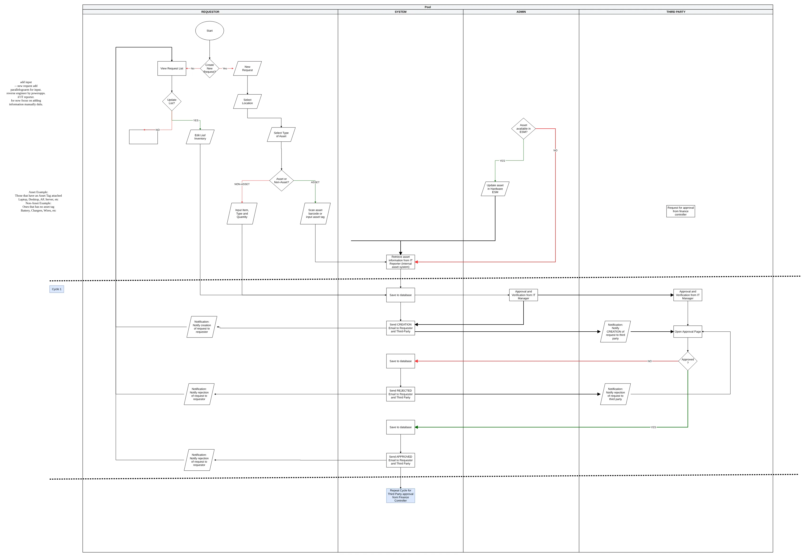
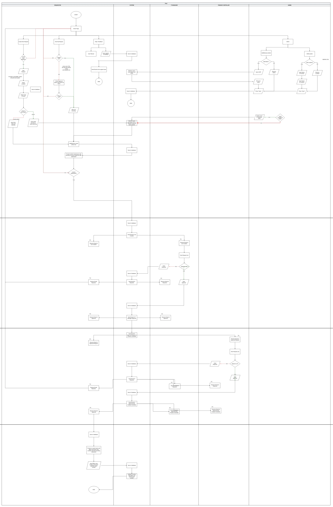
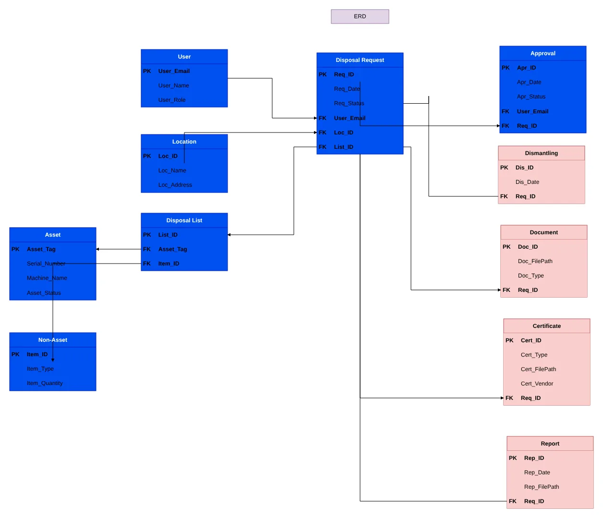
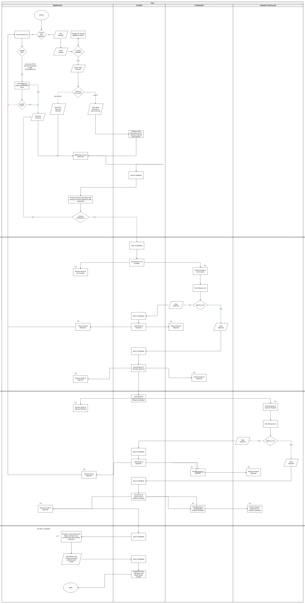
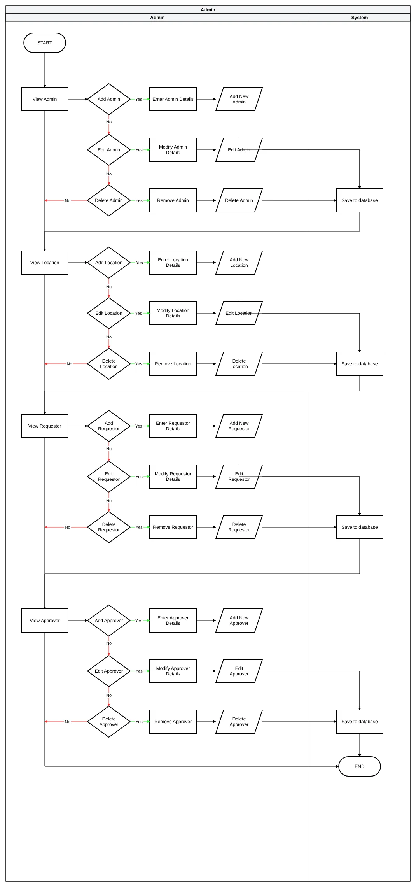
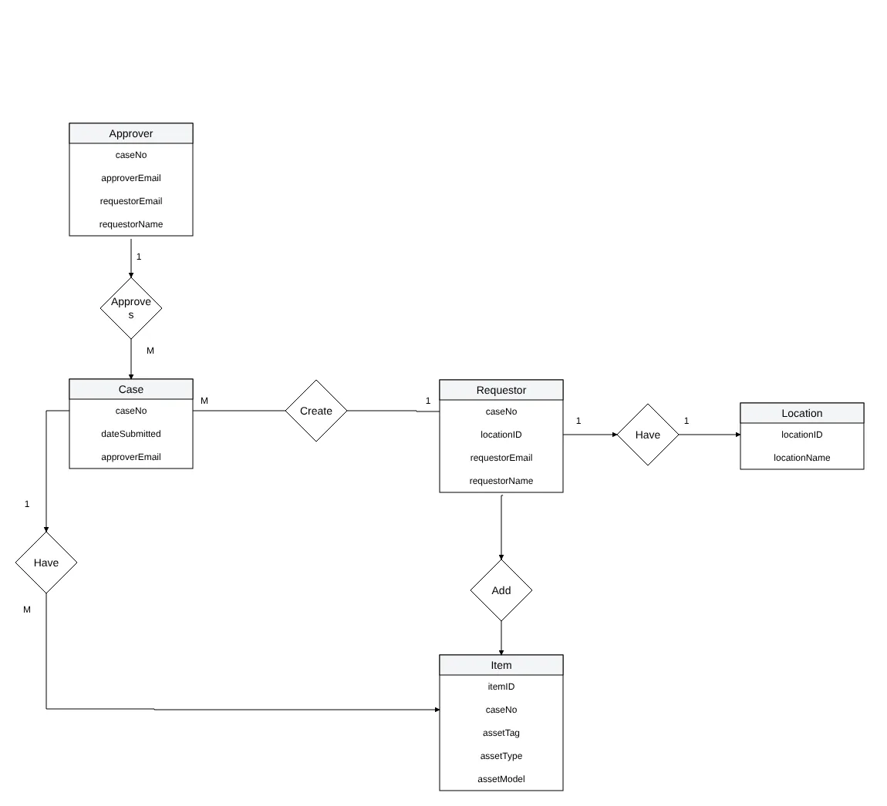

# Original draw.io charts

[`diagrams/it-disposal-charts.drawio`](diagrams/it-disposal-charts.drawio) is the draw.io file I used to
design the whole flow and the access controls, from the first LucidChart draft to the final version.
It has 9 pages, kept in the order I made them.

**[Open it in diagrams.net](https://app.diagrams.net/#Uhttps%3A%2F%2Fraw.githubusercontent.com%2F7YMERA%2Fit-asset-disposal-app-v1%2Fmain%2Fdocs%2Fdiagrams%2Fit-disposal-charts.drawio)**
(read-only in the browser, nothing to install). GitHub can't preview `.drawio` files itself.

In this public copy, one page name and two internal addresses were replaced with generic labels.

## The pages

| # | Page | What it shows |
|---|---|---|
| 1 | Ver1 from LucidChart | The first flowchart, moved over from LucidChart: lanes for User, System, Admin and Third-Party |
| 2 | MVP DISPOSAL | The minimum version: requestor, system, admin and a single "third party" approver, repeated for the Finance Controller |
| 3 | BULK SETTING ADJUSTMENT | IT Manager and Finance Controller get their own lanes; QUEST and IBase numbers added after approval |
| 4 | MID ROW ADJUSTMENT | Every email spelled out (who gets TO and CC), location requests, and the first admin actions |
| 5 | ADD HOME FUNCTION | A home page with Create, View My Requests and Help/Feedback, plus a user manual link |
| 6 | ERD (team draft) | A wide first ERD: user, location, asset, non-asset, request, approval, dismantling, documents, certificates, reports |
| 7 | (FINAL) ADMIN SEPARATION | **The final flow and access controls**: the admin lane split into view, add, edit and delete for admins, locations, requestors and approvers |
| 8 | ERD NORM | The ERD cut down and normalised to 3NF: Case, Requestor, Location, Item, Approver |
| 9 | Page-9 | The final flow again with drafts added ("save as draft" before submission) |

Page 8 became the [data model](data-model.md). Pages 7 and 9 became the [workflow](workflow.md) and
[roles and access](roles-and-access.md).

## Rendered pages

These images were rendered from the draw.io file for this repo; open the file itself for the exact
original layout.

Two ideas in the charts never made it into the app: looking up asset details automatically from the
internal asset system by scanning a barcode, and updating the asset's status in the hardware ESM after
disposal. Both needed access to SLB systems outside the project's scope, so items were typed in by hand.
