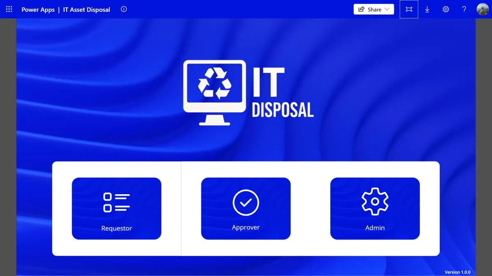

# Roles and access

Four roles came out of a design session with SLB's GoDigital team.

| Role | Can do |
|---|---|
| **Requestor** | Create cases, add and edit items while a case is a draft or rejected, submit for approval, add colleagues to the watchlist, record QUEST and IBase numbers once approved |
| **IT Manager** (1st level approver) | See cases waiting for them, approve or reject |
| **Finance Controller** (2nd level approver) | Final approval before anything is disposed |
| **Admin** | Manage locations and their approvers, admins and requestors |

## How the app decides who you are

- **Everyone is a requestor.** When the app starts, it reads your name and email from Microsoft 365 and
  adds you to the Requestor list if you're not there yet ([`App.pa.yaml`](../src/App.pa.yaml)). Nobody
  has to request access.
- **Approvers are found from the cases.** Pressing *Approver* on the login screen looks for cases where
  your email is the 1st or 2nd approver, then opens the matching approval screen
  ([`Login.pa.yaml`](../src/Login.pa.yaml)). Approver lists are never kept by hand; they follow the
  Location list.
- **Each approver only sees their own queue.** The 2nd level screen filters to cases that are
  *Pending 2nd Level Approval* **and** name you as the 2nd approver.
- **The watchlist widens access per case.** People on a case's watchlist see it on their Watchlists page
  and can act on it as the requestor would.

## In this copy of the source

The login screen in this copy shows all three buttons to everyone, which is how I tested every role
during development. In the final version, the Approver and Admin buttons only appear for people listed
as approvers or admins, so a regular user sees just *Requestor*.

