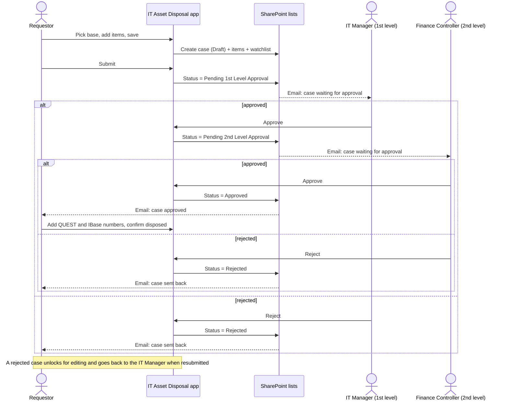

# Workflow and statuses

## The old process

1. **Identify e-waste.** IT staff pick out equipment that has reached end of life or failed, and take it apart.
2. **Log it in Excel.** Each item goes into a spreadsheet by hand: type, asset tag, device name, model, brand, quantity.
   There is a tab per device type, plus tabs for approval emails, the QUEST report and invoices.
3. **Email the IT Manager** with the list attached and wait for a reply.
4. **Forward to the Finance Controller** for the second approval, in the same email thread.
5. **Dispose.** Raise a QUEST risk report and IBase manpower requests, destroy hard disks and SSDs with
   photo proof, and hand everything to the facility team.

Where it broke down:

- Data lived in spreadsheets, inboxes and shared drives, so it was hard to find and easy to get out of sync.
- Approval status was buried in reply-all threads. Nobody could see at a glance where a request stood.
- Nobody was told automatically when something changed.
- There was no single record to show an auditor.

## The new process

The original draw.io flowcharts, from the first draft to the final version, are in [diagrams.md](diagrams.md).

## Statuses

| Status | Who acts next | Shown as |
|---|---|---|
| Draft | Requestor: add, edit or remove items, then submit | Light blue |
| Pending 1st Level Approval | IT Manager for that base | Amber |
| Pending 2nd Level Approval | Finance Controller for that base | Amber |
| Rejected | Requestor: edit and resubmit | Red |
| Approved | Requestor: record QUEST and IBase numbers, then dispose | Green |
| Disposed | Nobody, the case is closed | Grey |

Approvers are not picked by hand. Each base in the Location list has its own 1st and 2nd approver, and
those are copied onto the case when it is created.

## Notifications

Emails were sent by Power Automate flows that watch the SharePoint lists:

- **Case created or updated:** the requestor and anyone on the case's watchlist.
- **Submitted:** the 1st level approver.
- **Approved at 1st level:** the 2nd level approver, with everyone on the case copied.
- **Approved or rejected at 2nd level:** everyone on the case.
- **Contact Us form:** the development team, for questions and bug reports.

The flows run in SLB's tenant and are not part of the app file, so they aren't in [`src/`](../src).

## Which parts are in this copy

See [About this copy of the source](../README.md#about-this-copy-of-the-source) in the README.
